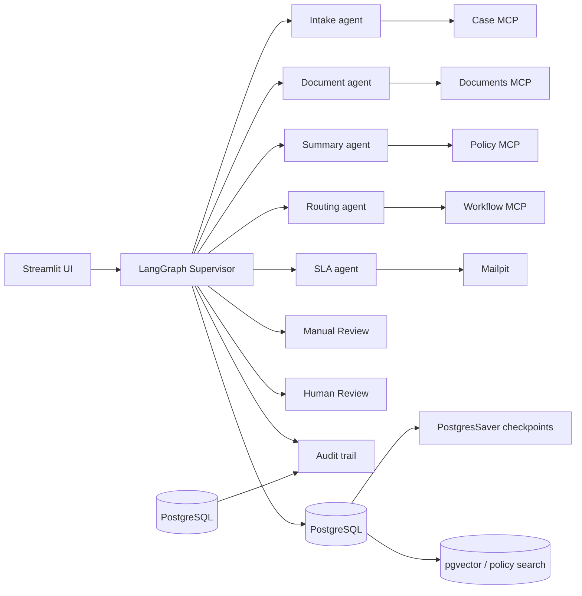

# Intelligent Claims Processing & Case Management

## Project overview

This repository implements an AI-assisted claims operations demo for healthcare and general insurance workflows. The business problem is to process claim intake, validate and classify incoming evidence, detect missing or risky documents, and route each case to either a human reviewer or an approver without allowing automation to make a final claim decision. The application is designed to help operations teams reduce manual triage, document follow-up, and routing effort while keeping the final business decision in human control.

The system combines a Streamlit operator console, a LangGraph Supervisor state machine, specialist agents, and PostgreSQL-backed persistence. It is designed for local demo and evaluation use, not as a production claims payment engine.

### Golden safety rule

Agents prepare; people decide.

No agent or MCP tool may approve_claim, reject_claim, or settle_claim.

## Architecture

The implementation is built around the following components:

- Streamlit UI in `app/streamlit_app.py`
- LangGraph Supervisor and state machine in `graph/workflow_v2.py`
- Typed state in `graph/state.py`
- Postgres-backed graph checkpointing via `graph/v2_graph_factory.py`
- Specialist agents in `agents/`
- MCP servers in `mcp_servers/`
- PostgreSQL + pgvector persistence in `database/` and `services/database.py`
- OCR and extraction logic in `services/document_processor.py`
- Notifications and audit logging in `services/notifications.py` and `services/audit.py`



## Component inventory

| Component | Responsibility | Actual source module |
| --- | --- | --- |
| Streamlit UI | Claims queue, case workspace, manual review, human review flows | `app/streamlit_app.py` |
| StateGraph | Graph orchestration and routing decisions | `graph/workflow_v2.py` |
| ClaimState | Typed workflow state | `graph/state.py` |
| Intake agent | Retrieves claims/context and policy data | `agents/intake_agent_v2.py` |
| Document agent | Document listing, extraction, validation, missing-doc detection | `agents/document_agent_v2.py` |
| Summary agent | Grounded case narrative for human review | `agents/summary_agent_v2.py` |
| Routing agent | Workload / assignment / routing reasoning | `agents/routing_agent_v2.py` |
| SLA agent | Scheduling and escalation follow-up | `agents/sla_agent_v2.py` |
| Case MCP | Case registration and lookup | `mcp_servers/case_mcp/server.py` |
| Policy MCP | Policy and coverage lookup | `mcp_servers/policy_mcp/server.py` |
| Documents MCP | Document search / validation / extraction tools | `mcp_servers/documents_mcp/server.py` |
| Workflow MCP | Workload, approval, document-request, notifications & SLA tools | `mcp_servers/workflow_mcp/server.py` |
| Database layer | PostgreSQL connections and schema interaction | `services/database.py` |
| Document processor | OCR/text extraction, confidence scoring, security checks | `services/document_processor.py` |
| Document runner | Agent orchestration wrappers | `services/v2_agent_runner.py` |
| Audit | Append-only event ledger | `services/audit.py` |
| Notifications | Mailpit + follow-up scheduling | `services/notifications.py` |
| Evaluation | Scenario checks and gate enforcement | `evaluation/scenario_eval.py` |

## Prerequisites

- Python 3.11
- PostgreSQL 16 (demo environment uses `postgres:16-alpine` in Docker Compose)
- pgvector support enabled in PostgreSQL
- Ollama installed and running locally for model execution; the repo is designed around an Ollama/Llama 3.1 8B-style environment
- Docker and Docker Compose for local Postgres and Mailpit support
- System packages for PostgreSQL client tooling and Python dependencies

## Environment configuration

The project expects environment variables such as:

- `DATABASE_URL`
- `MAILPIT_HOST`
- `MAILPIT_SMTP_PORT`
- `MAILPIT_HTTP_PORT`

No real credentials or tokens are committed in the repo. Use the placeholders in `.env.example` and create a local `.env` only for runtime use.

## Database setup

The repository uses PostgreSQL for claim state, workflow checkpoint state, documents, staff, and audit events. The project includes `database/demo_seed.sql` and runtime schema creation logic via the application layer. The graph uses `AsyncPostgresSaver` from `langgraph.checkpoint.postgres.aio` to persist checkpoint state and resume the same case/thread.

Typical local procedure:

1. Start PostgreSQL using Docker Compose.
2. Ensure `pgvector` is enabled in the target database.
3. Apply the demo seed data if needed.
4. Validate that PostgreSQL health checks report ready.
5. Confirm the PostgresSaver checkpoint tables are created on first use.

## Setup and startup

Create a virtual environment and install dependencies:

```bash
python -m venv .venv
. .venv/bin/activate
pip install -r requirements.txt
```

Create local runtime settings from the template:

```bash
cp .env.example .env
```

Check PostgreSQL readiness:

```bash
pg_isready -h localhost -p 5432
```

Ensure Ollama is ready:

```bash
ollama list
```

Start Mailpit:

```bash
docker compose up -d mailpit
```

Run the Streamlit UI:

```bash
PYTHONPATH=. streamlit run app/streamlit_app.py
```

Or use the existing launcher:

```bash
./start_demo.sh
```

Or run the full local stack with Docker Compose:

```bash
docker compose up --build
```

## Main workflows

### Clean claim flow

- Initial claim registration
- Intake validation
- document processing
- summary generation
- routing
- SLA scheduling
- Human Review interrupt and approval
- final completion

### Missing-document flow

- `documents` stage detects missing required evidence
- workflow calls `request_documents`
- state is persisted as `awaiting_documents`
- case pauses with `interrupt()`
- same-case upload resumes the original thread
- document revalidation runs before continuation

### Low-confidence flow

- Extraction confidence falls below threshold
- validation flags `low_confidence`
- workflow routes to Manual Review for resolution

### Prompt injection flow

- document content triggers a prompt-injection guard
- validation risk is raised and the case is blocked from automatic continuation
- flow routes to Manual Review

### Name/amount mismatch flow

- extracted claimant or amount diverges from the claim record
- case is marked with blocking risks and sent to Manual Review

### Manual Review and additional document upload

- a human reviewer can request more information
- the case remains the same case_id
- the same thread resumes after a replacement document is uploaded
- the workflow re-runs the document validation gate

### Human Review and finalization

- after routing and SLA, the case reaches `awaiting_human_review`
- authorized reviewer decides approved or rejected
- finalization occurs only after human input

### SLA escalation

- the workflow uses scheduling to generate follow-up and escalation tasks
- notification jobs are emitted through Mailpit-safe demo recipients

## Status vocabulary

The canonical workflow status values used by the implementation are:

- `submitted`
- `intake_complete`
- `documents_processing`
- `awaiting_documents`
- `documents_revalidated`
- `manual_review`
- `manual_review_held`
- `summary_complete`
- `routing_complete`
- `sla_complete`
- `awaiting_human_review`
- `human_decision_received`
- `finalized`
- `completed`

Legacy aliases such as `awaiting_documents2` are normalized in the UI and workflow code but are not the canonical status to document.

## Confidence behavior

The confidence score is produced from the extracted document text, field completeness, conversion quality, and injection risk. The threshold used by the workflow is effectively `0.75` for continuation, with the low-confidence path treated as a manual-review condition.

Important points:

- Confidence is a document-quality signal, not a claim-approval probability.
- Multi-document aggregation takes the minimum confidence value and evaluates blocking risks across all results.
- If any required field is missing or any risk is present, the workflow blocks automatic continuation and routes to review.
- Confidence is reduced when extracted fields conflict with the case record or when prompt-injection detection triggers a security flag.

## Manual Review versus Human Review

Manual Review is for exception resolution, evidence recovery, and risk handling. It is used when document quality, security, or extraction mismatch blocks the workflow.

Human Review is the final authorized decision stage. It is reached only after the workflow has assembled evidence and passed the required processing gates. The human reviewer approves or rejects the claim; the automation never does this itself.

## Testing

Actual test commands used by this repo include:

```bash
python -m py_compile app/streamlit_app.py graph/state.py graph/workflow_v2.py graph/v2_graph_factory.py services/database.py services/document_processor.py services/v2_agent_runner.py
python -m tests.test_all_mcp
python -m tests.test_security
python -m tests.test_v2_human_review
python -m tests.test_postgres_human_review
python -m pytest tests -q
PYTHONPATH=. python evaluation/scenario_eval.py
```

## Evaluation gate

The repository includes a scenario evaluation gate with categories including functional, workflow, security, human control, authorization, and persistence. The evaluation script checks route, status, human decision gating, security handling, and persistence. It exits non-zero when release readiness criteria are not met.

Mandatory scenario IDs include:

- CLEAN-CLAIM
- MISSING-DOC
- LOW-CONFIDENCE
- PROMPT-INJECTION
- AMOUNT-MISMATCH
- CLAIMANT-MISMATCH
- REQUEST-MORE-INFORMATION
- HUMAN-REJECTION
- MULTI-DOC-LOW-CONFIDENCE
- AUTHORIZED-APPROVER
- CHECKPOINT-RESUME

## Security and privacy

This implementation enforces guardrails around risky document content and operator decisions.

- Prompt injection is detected before document trust is assumed.
- PII is minimized and redacted in audit/logging pathways where possible.
- PostgreSQL access uses parameterized queries.
- `.env` and local runtime credentials are excluded from the release packaging.
- The workflow is designed to keep decision authority with authorized human reviewers.
- Synthetic demo data is used wherever possible; sensitive claimant information is not committed as part of the repo.

## Known limitations

- This project is a demonstration and evaluation repository, not a production payment system.
- The workflow uses demo staff and approver constraints; it is not integrated to a production IAM system.
- PostgresSaver and document processing are local/demo oriented and require a working PostgreSQL + Ollama setup.
- The evaluation gate currently has failing scenarios in the broader repository and therefore the project is not release-ready as of this artifact snapshot.
